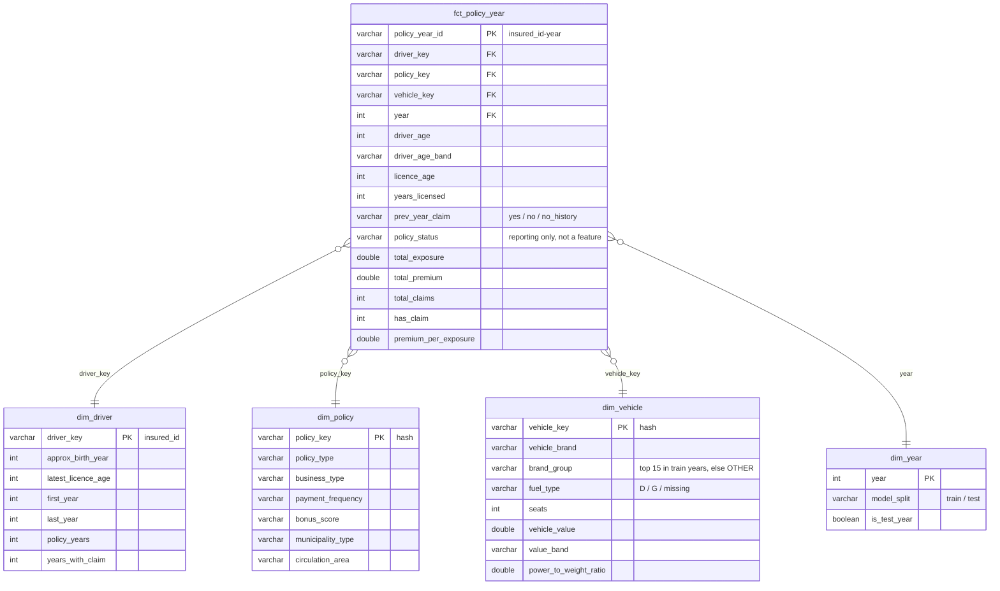

# dbt star schema (DuckDB)

A [dbt](https://docs.getdbt.com/) project that models the raw motor portfolio into a star schema
in DuckDB: one fact table at the policy-year grain and four dimensions, with data tests.
It reads the semicolon-delimited CSV directly (no separate load step) through
[dbt-duckdb](https://github.com/duckdb/dbt-duckdb).

## Star schema



| Model | Grain | Notes |
|---|---|---|
| `stg_policies` (view) | insured × year | Typed and renamed (`vehicle_age` → `years_licensed`, `age_driving_licence` → `licence_age`); licence age < 16 → null; missing fuel type → `missing`; exact duplicate (insured, year) rows removed (none expected in the real file; sql query 09 counts them). |
| `fct_policy_year` | insured × year, exposure > 0 | Same population as `src/clean.py`. `prev_year_claim` uses only the immediately preceding year, like the model feature. |
| `dim_driver` | insured | Stable attributes; age and years licensed change yearly, so they stay on the fact. |
| `dim_policy` | policy-terms combination | Small "junk" dimension of policy codes and rating territory, with readable labels. |
| `dim_vehicle` | vehicle profile | The data has no vehicle id, so the key hashes the vehicle attributes. `brand_group` matches the model's top-15 brand grouping. |
| `dim_year` | year | Train (2022–23) / test (2024) split. |

**Tests** (`models/*/schema.yml`, `tests/`): `not_null` and `unique` on every key,
`relationships` from each fact foreign key to its dimension, `accepted_values` on the category
codes, `prev_year_claim`, `has_claim` and the year split, and two singular tests (exposure in
(0, 1], at most 16 brand groups). Accepted values for `policy_status` are a guess, so that test only warns.

## How to run

dbt has its own pinned requirements, so it gets its own virtualenv:

```bash
python -m venv .venv-dbt
.venv-dbt\Scripts\activate          # macOS/Linux: source .venv-dbt/bin/activate
pip install -r requirements-dbt.txt
cd dbt
dbt build                           # SYNTHETIC fixture (default)
```

On the real data (PowerShell; on macOS/Linux use `MOTOR_CSV_PATH=... dbt build`):

```powershell
$env:MOTOR_CSV_PATH = "../data/raw/motor_portfolio.csv"
dbt build
```

| Environment variable | Default | Used in |
|---|---|---|
| `MOTOR_CSV_PATH` | `../tests/fixtures/policies_sample.csv` (SYNTHETIC) | `models/staging/sources.yml` |
| `DBT_DUCKDB_PATH` | `target/motor_dbt.duckdb` | `profiles.yml` |

Paths are relative to the `dbt/` folder. `profiles.yml` lives in this folder, so dbt finds it when
run from here. Both the database and `target/` are git-ignored.

`dbt docs generate && dbt docs serve` opens a browsable lineage graph of the models.

CI runs `dbt build` on the synthetic fixture on every push (see `.github/workflows/ci.yml`).
